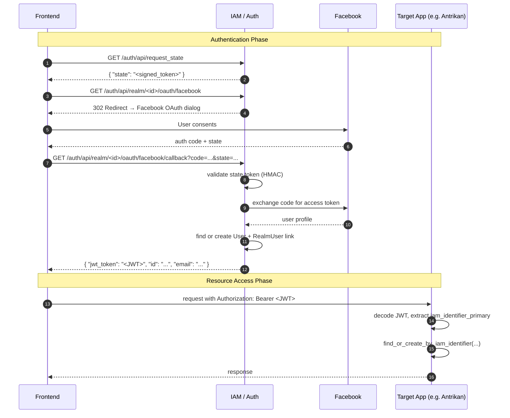
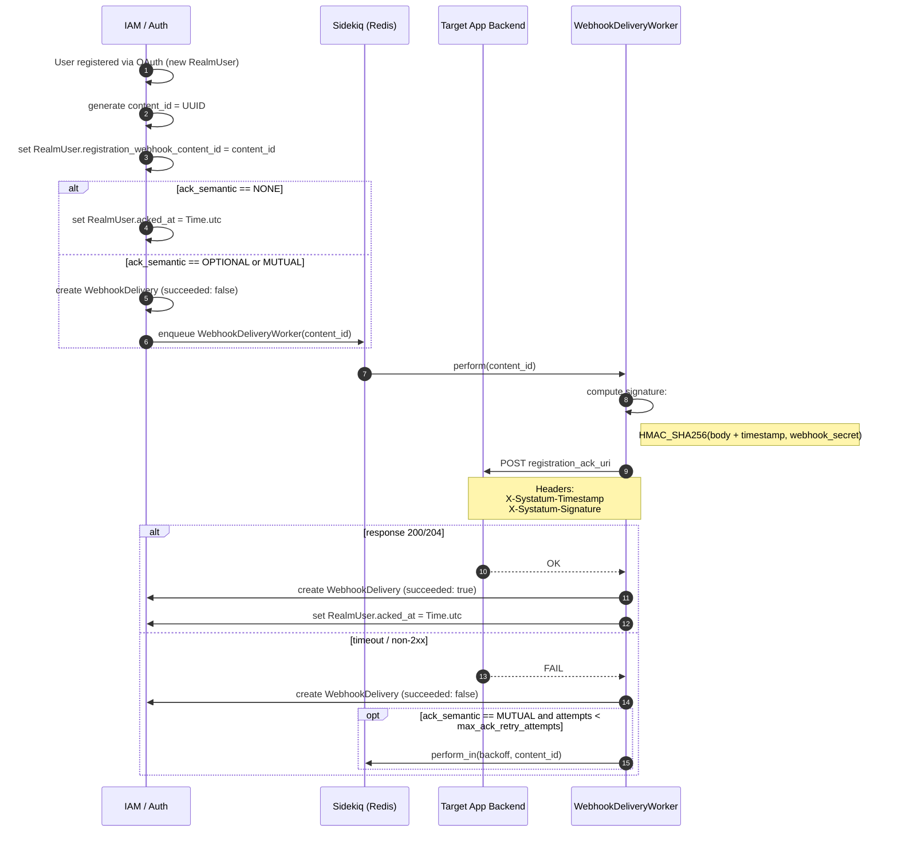

# Auth (IAM)

Handles everything related to cross-app authentication and identity management.

## Architecture

Our platform uses a multi-realm, multi-database architecture. Each realm (app) operates against its own database. Auth/IAM serves as the centralized identity provider (IdP) for all realms via OAuth 2.0 / Facebook SSO.

| Concept | Description |
|---------|-------------|
| **User** | A person with an account in the system. Has a canonical `iam_identifier_primary` assigned by IAM. |
| **Realm** | An OAuth client registration - a trusted app (e.g. Antrikan, BilQuran) that delegates authentication to IAM. Each realm brings its own Facebook App credentials so the user sees the correct branding. |
| **RealmUser** | A federated identity link binding a User to a specific Realm (like an OAuth `sub` per client). Replaces the old monolithic `Provider` model. |
| **WebhookDelivery** | Tracks delivery attempts for outbound registration notifications sent to a realm's backend. |

## Route Structure

All routes are prefixed under `/auth` (registered in the root route map):

| Scope | Route | Method | Handler |
|-------|-------|--------|---------|
| User | `/api/user/signup` | POST | `SignUpHandler` |
| User | `/api/user/signin` | POST | `SignInHandler` |
| User | `/api/user/update_password` | POST | `PasswordUpdateHandler` |
| User | `/api/user/request_password_reset` | POST | `PasswordResetInitiateHandler` |
| User | `/api/user/my-bio` | GET | `MyBioShowHandler` |
| User | `/api/user/my-bio/update` | PATCH, POST | `MyBioUpdateHandler` |
| User | `/api/user/my-picture` | POST, PATCH | `MyPictureUploadHandler` |
| Realm | `/api/realm/create` | POST | `RealmCreateHandler` |
| Realm | `/api/realm/<realm_id>/oauth/<provider>` | GET | `OAuthInitiateHandler` |
| Realm | `/api/realm/<realm_id>/oauth/<provider>/callback` | GET | `OAuthCallbackHandler` |
| Generic | `/api/request_state` | GET | `RequestStateHandler` |
| Org | `/api/organizations/create` | POST | `OrganizationCreateHandler` |
| Org | `/api/organizations/<id>` | PATCH, POST | `OrganizationUpdateHandler` |
| Org | `/api/organizations/<id>/delete` | DELETE | `OrganizationDeleteHandler` |
| Webhook | `/api/webhooks/iam` | POST | `IamWebhookHandler` |

## OAuth / Facebook SSO



### IAM-mode Guardrails

Authentication endpoints are IAM-only by design. If `LIGO_APP_MODE` is not `iam`, these endpoints return `404`.

### State Token

CSRF protection uses HMAC-signed nonce tokens via `SignedToken`. A `state` parameter is generated by `RequestStateHandler`, verified in `OAuthCallbackHandler`. Missing or invalid state is logged but still processed (the upstream library has a known gap and a future `multi_auth` upgrade will make validation mandatory).

## Realm Registration

When an app administrator registers a new Realm via `POST /auth/api/realm/create`:

1. A 12-character nanoid `id` is generated for the Realm
2. Three credential pairs are created (raw values returned once, never stored):
   - **`api_secret_key`** (60 chars) for backend-to-backend communication, stored as SHA-256 hash
   - **`api_client_key`** (60 chars) for frontend-to-IAM communication, stored as SHA-256 hash
   - **`webhook_secret`** (15 chars) for signing outbound webhook payloads (used in `X-Systatum-Signature`)
3. The realm's Facebook App credentials (`app_id`, `app_secret`) are stored for the OAuth flow
4. An `ack_semantic` is chosen (see below)

## Acknowledge Semantic (Registration Webhook)

When a new User registers through a Realm's OAuth flow, IAM creates a `RealmUser` link. The `ack_semantic` on the Realm controls how the target app's backend is notified:

| Semantic | Behavior |
|----------|----------|
| **NONE** | No webhook. `RealmUser#acked_at` is set to `Time.utc` immediately at RealmUser creation. |
| **OPTIONAL** | A webhook `POST` is sent to `registration_ack_uri` once. No retries. `acked_at` is never set automatically. |
| **MUTUAL** | A webhook `POST` is sent to `registration_ack_uri` with exponential backoff retries until the target responds `200`/`204`. `acked_at` is set only upon confirmation. |

### Webhook Delivery



### Webhook Payload

```json
{
  "event": "registration",
  "user_id": "<hashed_user_id>",
  "email": "user@example.com",
  "realm_user_id": 42
}
```

### Webhook Signature Verification

The target app SHOULD verify every incoming webhook:

1. Extract `X-Systatum-Timestamp` and `X-Systatum-Signature` from the request headers
2. Compute `HMAC_SHA256(payload_body + timestamp, webhook_secret)` where `webhook_secret` is retrieved from the shared IAM Realm credentials
3. Compare the computed signature with the `X-Systatum-Signature` header using constant-time comparison
4. If they don't match, discard the payload (respond `400`)

### Retry

The maximum number of retry attempts is set per Realm via `max_ack_retry_attempts` (default: 50). After exhausting all attempts, the delivery is abandoned permanently.

See the top-level [README.md](../../README.md#webhook-delivery) for the webhook protocol, `WebhookDeliveryWorker`, `WebhookDelivery` model, and target-app receiver details.

The enqueuer (`OAuthTokenAuthenticatorService`) sets `job.retry` to the realm's `max_ack_retry_attempts` when `ack_semantic` is `MUTUAL`, so Sidekiq handles retry count and backoff automatically.

### Target-App Webhook Receiver

The `auth` package provides out-of-the-box `POST api/webhooks/iam` endpoint via `Auth::IamWebhookHandler` to handle IAM's ack semantic. It verifies the HMAC-SHA256 signature and resolves the user locally.

**Flow:**
1. IAM sends signed POST to the target app's `registration_ack_uri`
2. `IamWebhookHandler` validates in order:
   - Request body present (400 if missing)
   - `X-Systatum-Timestamp` and `X-Systatum-Signature` headers present (403 if missing)
   - `LIGO_WEBHOOK_SECRET` environment variable is configured (403 if not)
   - HMAC-SHA256 signature matches computed value (403 if mismatch)
3. Calls `Auth::User.find_or_create_by_iam_identifier` to create/resolve the user
4. Responds `204 No Content`

## JWT Token

The JWT issued by IAM contains the following claims:

| Claim | Type | Description |
|-------|------|-------------|
| `id` | `int` | User's database ID |
| `iat` | `int` | Issued-at timestamp (epoch) |
| `exp` | `int` | Expiry timestamp (epoch), currently 1 year |
| `puat` | `float` | Password-updated-at timestamp. If the database value no longer matches, the token is considered obsolete (password was changed). |
| `ver` | `int` | Token structure version (currently `2`) |
| `iam_identifier_primary` | `string` | Cross-realm canonical user identifier (UUID). This is the primary key for resolving users across realms. |
| `given_name` | `string?` | User's first name |
| `family_name` | `string?` | User's last name |
| `email` | `string?` | User's email |
| `role` | `int` | User's role level |

### Cross-realm User Resolution

Target apps (Antrikan, Workaty) resolve IAM-authenticated users via `JwtPayloader.find_by_jwt_token`, which calls `IamIdentifiable.find_or_create_by_iam_identifier`:

1. Look up by `iam_identifier_primary` (the canonical UUID)
2. Fallback: match by email (for legacy users who predate the IAM identifier)
3. Create a new local user record if neither exists

All IAM instances must share the same `Marten.settings.secret_key` for JWT verification to work across realms.

### `iam_identifier_primary`

- Generated only in IAM mode. If the current `LIGO_APP_MODE` is not `iam`, the identifier generation is skipped.
- A UUID assigned the first time a user goes through OAuth or when `jwt_token` is called.
- Never changes for the lifetime of the user account.

## Upstream OAuth Provider Support

Currently supported: **Facebook** (scope: `email`).

Unsupported providers return a `400` error from `OAuthFacility` (which raises on `EXPLICIT_PROVIDER_SCOPES` lookup failure). Adding a new provider requires:

1. Adding an entry to `Auth::OAuthFacility::EXPLICIT_PROVIDER_SCOPES`
2. Adding a `MultiAuth.config(...)` call for the provider credentials
3. Adding the provider enum value to `Auth::ProviderType`

## Email Verification

When a user signs up via the `api/user/signup` endpoint, their email address is marked as unverified (`is_email_address_verified: false`). The user must verify their email before they can retrieve a JWT token (sign-in is blocked for unverified users). The following endpoints facilitate this flow:

| Route | Method | Purpose |
|--------|--------|--------|
| `/api/user/request-email-verification` | GET | Requests a verification email. Query params: `email` (required), `redirectionUri` (optional, embedded in all downstream verification URLs), `expiredAt` (optional ISO 8601 timestamp, default `null` = never expires). Sends an email with a verification link (one-click) and a 6-character alphanumeric code. |
| `/api/user/verify-email/confirm` | GET | Verifies the email address. Query params: `code` (required, 6-char code), `user` (optional, `hashed_id` to scope the lookup), `redirectionUri` (optional). If already verified: redirects to `redirectionUri` or shows "Email address verified" page. If the link is valid: marks the user as verified, then redirects or shows success page. |
| `/api/user/verify-email/form` | GET | Renders an HTML form for manual code entry. Query params: `user` (required, hashed_id), `redirectionUri` (optional). If the verification link has expired (per `expiredAt`): shows an expiry message and automatically sends a new verification email. |

> [!NOTE]
> Facebook OAuth users are automatically marked as verified since Facebook provides verified email addresses. You can't even perform Facebook Login otherwise (Facebook requires verified public email address).
