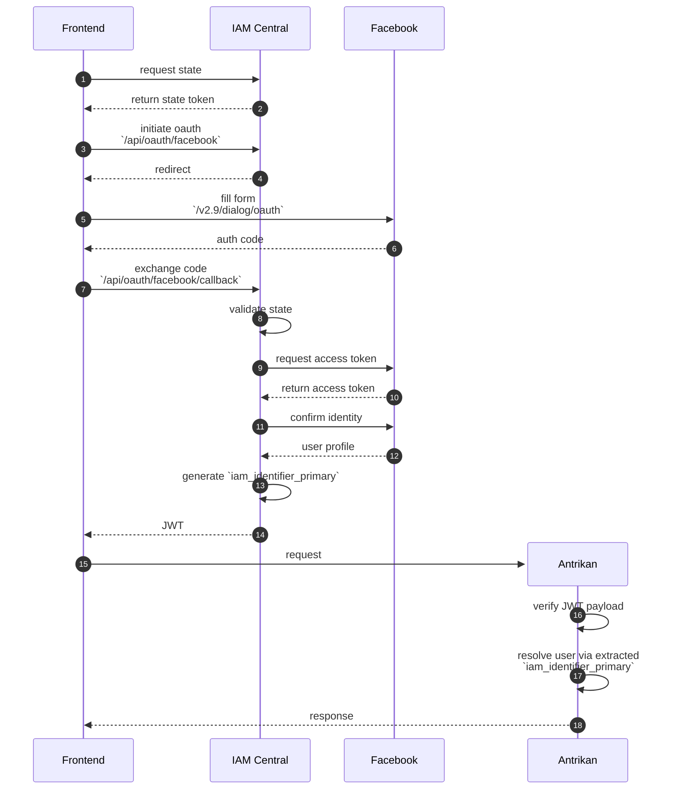

# Auth (IAM)

Handles everything related to cross-app authentication.

## OAuth

Our platform uses a multi-realm, multi-database architecture, where each realm operates against its own database (for example, workaty uses the Workaty database and antrikan uses the Antrikan database). Auth/IAM serves as the centralized identity and authentication provider for all other realms.

Auth exposes the following OAuth routes:

| Route | What it does |
|--------|--------|
| `/api/oauth/<provider>` | Initiates OAuth by redirecting to the provider authorization URL (scope mapping currently includes `facebook -> email`) |
| `/api/oauth/<provider>/callback` | Handles callback, validates `state`, exchanges `code` through `multi_auth`, authenticates or creates user, then returns JWT payload |
| `/api/request_state` | Returns a signed `state` string for CSRF protection |

The configured provider path in this implementation is Facebook. Unsupported providers return a `400` error from the OAuth flow.

### IAM-mode Guardrails

Authentication endpoints remain IAM-only by design.  
If app mode is not `iam`, these endpoints return `404` intentionally.

JWT payload includes `iam_identifier_primary` plus identity claims (fields) for cross-realm identity resolution.  
All IAM central and service instances must share the same `Marten.settings.secret_key` for JWT verification compatibility.

`iam_identifier_primary` is generated only in IAM mode as part of token generation.

### Facebook SSO

Our typical SSO flow consist of two main phases: (1) user authentication phase and (2) resource access phase. Authentication is performed with a web-based OAuth via Facebook through IAM which returns a JSON Web Token (JWT) containing user identifier (`iam_identifier_primary`), the Frontend then uses this JWT to perform secured API requests to apps (Antrikan, etc). We can illustrate this in more detail as the following sequence diagram. It should be noted that IAM and Antrikan is logically grouped as the Backend of the platform, each with their own databases.

